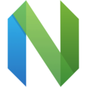

# Apps

My experience with the apps and tools I've used on macOS: what each one does and what I think of it.

## Contents

- [Operating system](#operating-system)
- [Terminals](#terminals)
- [Code editors](#code-editors)
- [Browsers](#browsers)
- [Note-taking](#note-taking)
- [API clients](#api-clients)
- [Database clients](#database-clients)
- [Running Windows apps](#running-windows-apps)
- [Window management](#window-management)
- [Hotkeys](#hotkeys)
- [Productivity](#productivity)
- [Python](#python)
  - [Package managers](#package-managers)
  - [Type checkers](#type-checkers)

## Operating system

macOS is a proprietary OS and not very privacy-friendly. You can cut down what it shares: skip iCloud and the Apple ID, turn on FileVault disk encryption, and switch off analytics and data collection in Privacy & Security. That still isn't full control, which is where Asahi Linux comes in. Even so, Macs are a very good combination: carry-on size with serious performance.

| Logo | Project | What it does | My take |
|---|---|---|---|
|  | [macOS](https://www.apple.com/macos/) | Apple's desktop OS for Macs | Excellent hardware integration and battery life, but closed and not private by default. The settings above help, but you're still trusting Apple. |
|  | [Asahi Linux](https://asahilinux.org) | Linux for Apple Silicon Macs, built by reverse-engineering the hardware | Supports M1–M3, but hardware integration is still poor, especially battery life, which is exactly what Macs are best at. |
|  | [Omarchy](https://github.com/basecamp/omarchy) | DHH's opinionated Arch Linux + Hyprland setup | Added Apple Silicon support in 4.5 on top of Asahi's work and is moving much faster. My bet for the go-to Linux setup in the future. |

> **The Asahi licence change.** In November 2026 Asahi moved all its code from the permissive MIT licence to GPLv2-or-later, saying people had run its unreleased code through LLMs to hide where it came from. It came two days after Omarchy 4.5 shipped Apple Silicon support, so many read it as aimed at Omarchy; DHH says Omarchy complies with the licences and publishes its kernel changes. Asahi stays open source: the GPL just requires anyone distributing a modified version to publish its source under the same licence. ([It's FOSS](https://itsfoss.com/news/asahi-linux-drops-mit-for-gpl/), [DHH interview](https://itsfoss.com/interview/dhh-asahi-omarchy-take/))

## Terminals

| Logo | Project | What it does | My take |
|---|---|---|---|
|  | [Ghostty](https://ghostty.org) | Fast, native terminal written in Zig | Since 1.4 it's really good: useful utilities out of the box, the full Kitty graphics protocol, easy to configure, and fast. My daily driver. |
|  | [kitty](https://sw.kovidgoyal.net/kitty/) | GPU-accelerated terminal, home of the Kitty graphics protocol | A good terminal, just not my cup of tea. |
|  | [Terminal](https://support.apple.com/guide/terminal/welcome/mac) | The built-in macOS terminal | Lacks everything listed above. |
|  | [iTerm2](https://iterm2.com) | Feature-packed macOS terminal | A Swiss Army knife, and definitely better than the default one. |
|  | [Alacritty](https://alacritty.org) | Minimal GPU-accelerated terminal written in Rust | Still maintained, but minimal by design: no tabs, splits or images, so you need tmux or similar on top. |

## Code editors

| Logo | Project | What it does | My take |
|---|---|---|---|
|  | [VSCodium](https://vscodium.com) | VS Code built from source without Microsoft's telemetry and branding | The best editor there is: a huge extension ecosystem (via Open VSX) and solid `.ipynb` support, which is big for me. It doesn't collect your data the way its proprietary counterpart does. |
|  | [Zed](https://zed.dev) | Fast, native editor written in Rust | A good editor. I'd move to it once it has proper `.ipynb` support and a Data Wrangler equivalent; its notebook editor is still early. |
|  | [JetBrains IDEs](https://www.jetbrains.com/pycharm/) | Commercial IDEs such as PyCharm | Proprietary bloat, and the full feature set costs money. PyCharm's debugger has a nice UI, but otherwise the VS Code debugger does the same job. |
|  | [Neovim](https://neovim.io) | Extensible Vim-based terminal editor | A good alternative with the best configuration potential, but `.ipynb` support still isn't reliable: molten.nvim and the other notebook plugins don't work well enough yet. |

## Browsers

Most browsers are either Chromium-based or Gecko-based (Firefox and its forks). [Ladybird](https://ladybird.org), a new independent engine, plans an alpha in 2026 and a beta with a downloadable app in 2027. In my experience Gecko eats a lot of RAM even with a few tabs open, and because fewer people use it, sites are tested on it less. Chromium is fast and what most of the web is built against.

| Logo | Project | What it does | My take |
|---|---|---|---|
|  | [Brave](https://brave.com) | Chromium-based browser with built-in ad and tracker blocking | The best mix of performance and privacy I've found. Brave's own extras (rewards, wallet, AI) can be turned off. Some sites occasionally load badly, but that's the cost of privacy nowadays. |
|  | [Firefox](https://www.mozilla.org/firefox/) | Mozilla's Gecko-based browser | Runner-up. Full uBlock Origin and lots of open-source privacy extensions, and you can customise it however you want. Really good, but it eats a lot of RAM. |
|  | [Zen](https://zen-browser.app) | Firefox-based browser with a polished UI and workspaces | Same strengths as Firefox, plus a nicer UI and spaces, but it uses unbelievable amounts of RAM, which many users report too. If that gets fixed, I'd use it. |
|  | [LibreWolf](https://librewolf.net) | Privacy-hardened Firefox fork | The strict defaults break a good share of sites. |
|  | [Helium](https://helium.computer) | Chromium browser built on ungoogled-chromium, with uBlock Origin built in | Genuinely private (no Google services or telemetry, uBlock Origin preinstalled, anti-fingerprinting), but it lacks the basics: no sync, no mobile app and no DRM for streaming, and it's still a small beta project. |
|  | [ungoogled-chromium](https://github.com/ungoogled-software/ungoogled-chromium) | Chromium with Google integration removed | Very bare, and there's no built-in place to get or update extensions, so you install them by hand. |

## Note-taking

| Logo | Project | What it does | My take |
|---|---|---|---|
|  | [Obsidian](https://obsidian.md) | Markdown knowledge base with links and plugins | Good overall and has everything you might need, but it's closed source. |
|  | [Neovim](https://neovim.io) + a Markdown renderer | Markdown notes written and rendered inside Neovim | Probably where I'll migrate. |
| | Other open-source note apps | Joplin, Logseq, AppFlowy and similar | Open source, but they usually come with paid tiers, which isn't great. |

## API clients

| Logo | Project | What it does | My take |
|---|---|---|---|
|  | [Postman](https://www.postman.com) | API platform for building and testing requests | Has shifted heavily to the cloud, which makes it the worst option for privacy or speed. Very slow to start for an app whose only job is to send requests. |
|  | [Bruno](https://www.usebruno.com) | Offline-first, open-source API client that keeps collections as files | Way better. It has paid tiers, but they're aimed at companies and big teams. |
|  | [Insomnia](https://insomnia.rest) | Open-source API client by Kong | Same as Bruno: a solid open-source alternative with paid team plans. |

## Database clients

GUI clients are great for quick data analysis or small-to-medium fetches. Beyond that, think about the database architecture and how connections are handled instead of leaning on a client.

| Logo | Project | What it does | My take |
|---|---|---|---|
|  | [DBeaver](https://dbeaver.io) | Universal database client | Nothing beats it, and it has everything you might need, but fetch speed and app performance aren't the best. |
|  | [VS Code SQL extensions](https://github.com/mtxr/vscode-sqltools) | Database access inside the editor, e.g. SQLTools | Having everything in one app is nice, but the UI is clunky. |

## Running Windows apps

| Logo | Project | What it does | My take |
|---|---|---|---|
|  | [CrossOver](https://www.codeweavers.com/crossover) / [Wine](https://www.winehq.org) | Run Windows apps through a translation layer, without Windows; CrossOver is the commercial, polished version of Wine | They work well, but not with every app. Each app gets its own separate environment. |
|  | [Parallels Desktop](https://www.parallels.com) | Virtual machine running Windows on Apple Silicon | Will get almost any Windows app or game working, but it needs a paid licence (mostly a subscription) and it's heavy. |

## Window management

| Logo | Project | What it does | My take |
|---|---|---|---|
|  | [yabai](https://github.com/koekeishiya/yabai) | Tiling window manager controlled from the command line | Customisable and does one job without bloat. It needs tinkering, learning and SIP disabled, but it can be very fast because it talks to the window server directly. Floating windows with bsp tiling on demand and control over window shapes is the way to go; Spaces management comes second. |
|  | [Raycast](https://www.raycast.com) | Launcher with built-in window management | Limited window management and app control, it comes with many features I don't want, and under high RAM load it stops working reliably. |
|  | [AeroSpace](https://github.com/nikitabobko/AeroSpace) | i3-like tiling window manager with its own virtual workspaces | Doesn't need SIP disabled, but users report it slowing down under heavy CPU load, with workspace switching staying slow until a restart. |

## Hotkeys

| Logo | Project | What it does | My take |
|---|---|---|---|
|  | [Karabiner-Elements](https://karabiner-elements.pqrs.org) | Low-level keyboard remapper | Doesn't work reliably under high load, and it installs a separate driver and helper apps alongside it. |
| | [skhd.zig](https://github.com/jackielii/skhd.zig) | Hotkey daemon, a Zig port of skhd | The original skhd has gone quiet, so skhd.zig took over. Config-compatible with skhd, an expressive syntax, can do anything I need for key bindings, and fast. |
|  | [Raycast](https://www.raycast.com) | Launcher with hotkey support | Solid built-in hotkey tools that work reliably out of the box. |

## Productivity

| Logo | Project | What it does | My take |
|---|---|---|---|
|  | [Raycast](https://www.raycast.com) | Launcher that replaces Spotlight, with extensions | Can stand in for the Dock, maps Caps Lock, and covers key bindings, window management and an AI assistant. |
|  | [Vorssaint](https://github.com/vorssaint/vorssaint-utils) | Free, open-source, modular menu-bar toolkit | A new app with almost everything you might need: remaps, app uninstalling and cache cleanup, a per-app audio mixer, and a bunch of quality-of-life features. |

## Python

### Package managers

| Logo | Project | What it does | My take |
|---|---|---|---|
|  | [uv](https://docs.astral.sh/uv/) | Python package and project manager written in Rust, by Astral | The best tool. It handles dependencies, building packages, multiple Python versions on one machine and tools. Very fast, and great for CI/CD pipelines. |
|  | [Poetry](https://python-poetry.org) | Dependency manager and packaging tool | Really bad: there are three different ways to install and manage it, and it needs Python already installed plus pyenv alongside it, since if you work with Python you probably have several versions. |

Anything other than these isn't viable.

### Type checkers

Conformance below means the share of the official [typing conformance suite](https://htmlpreview.github.io/?https://github.com/python/typing/blob/main/conformance/results/results.html) a checker passes. Scores move fast, so check the dashboard for current numbers.

| Logo | Project | What it does | My take |
|---|---|---|---|
|  | [basedpyright](https://github.com/DetachHead/basedpyright) | Fork of pyright with stricter rules and Pylance features | My pick. It inherits pyright's conformance, among the highest of any checker, and it's relatively fast. It installs from PyPI with Node bundled, so CI needs no separate Node install. |
|  | [mypy](https://mypy-lang.org) | The original Python type checker | Rusty-dusty: it has to stay compatible with most Python versions and sometimes misses checks. Its conformance is around 60%. |
|  | [ty](https://docs.astral.sh/ty/) | Rust type checker from Astral, the makers of uv | Very fast, but still in beta, with conformance well behind the others. Waiting for it to become feature-complete. |
|  | [Pyrefly](https://pyrefly.org) | Rust type checker from Meta | Fast and stable since 1.0 (May 2026), with over 90% conformance: ahead of mypy and ty, behind pyright. |